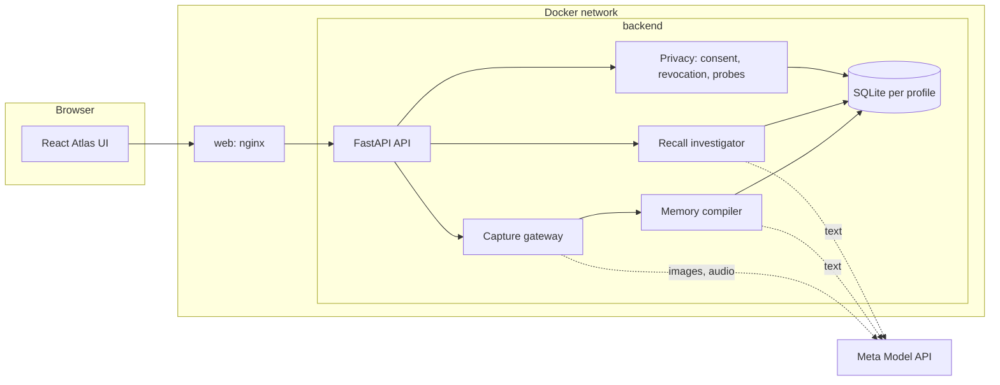

# Architecture

## The parts

Only the UI is published on the host (127.0.0.1). The backend is reachable only through the `web` service on the Docker network, and the SQLite file lives in a named volume.

## Request flow

1. **Add a memory.** The browser sends a photo, voice, video or note to `POST /capture/preview`. Muse reads it and returns a *draft* of what it found and what it still needs to ask. Nothing is stored. After the person answers (place, which speaker they are, whether anyone else agreed), `POST /capture/commit` stores it. Saving runs as a background job the page polls.
2. **Ask a question.** `POST /recall/ask` runs the investigator over the claims graph and returns an answer, a status (`answered`, `partial`, `abstained`) and the cited claims.
3. **Withdraw consent.** `POST /consent/grants/{id}/revoke` (or `/withdraw` for the owner) recomputes support, deletes what is unsupported, runs the seven leak checks and returns a receipt.

## Code layout

| Path | What lives there |
|---|---|
| `backend/app/api.py` | HTTP routes and request validation |
| `backend/app/capture/` | consent gateway, upload previews and drafts, commit, local redaction, media checks |
| `backend/app/compiler/` | perceive, extract, resolve, derive, contradictions, episodes, to-do scan |
| `backend/app/recall/` | the investigator loop, its graph tools, the recall service |
| `backend/app/privacy/` | consent grants, the privacy filter, revocation, leak probes, export, expiry clock |
| `backend/app/llm/` | Meta client, record/replay cache, metering, factory |
| `backend/app/corrections.py` | user corrections that supersede claims |
| `backend/app/profiles/` | sign-up, sign-in and a private database per profile |
| `backend/app/insights/` | dashboard counts: model usage and day coverage |
| `backend/app/evaluation/` | the benchmark against a retrieval baseline |
| `backend/app/schema.sql`, `migrate.py` | the database and its upgrade path |
| `frontend/src/` | React components, hooks, pure utilities (unit tested) |
| `fixtures/` | the scripted demo day, recorded model responses, demo profile snapshots |
| `eval/` | evaluation questions and results |
| `docs/` | implementation plan, setup, Docker, deployment, evaluation, handoff |

## Design rules

- **Code decides, the model proposes.** Storage, visibility and deletion are deterministic.
- **Text only.** `media_bytes_retained` is constrained to 0 in the schema.
- **Everything that reads a claim goes through the privacy filter**, so a revoked, superseded or unauthorised claim never reaches the model unless history is asked for.
- **Every model call goes through one client**, which meters it (counts and sizes only) and can record and replay it, so the app, the demo and the test suite run offline.
- **Stateless questions.** Earlier chat turns are not fed back to the model, so a forgotten fact cannot leak through conversation history.

## Modes

The model client runs in one of three modes, always shown in the UI:

| Mode | Behaviour |
|---|---|
| `live` | Calls the Meta Model API. Adding your own memories needs this. |
| `record` | Live, and caches each response by request hash. |
| `replay` | Offline: cached responses only. This is the default and needs no key. |
